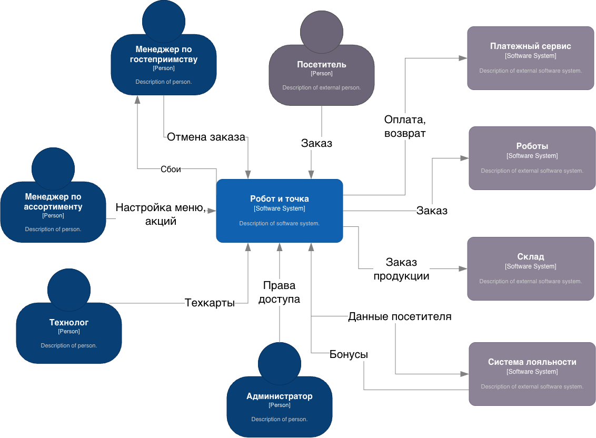
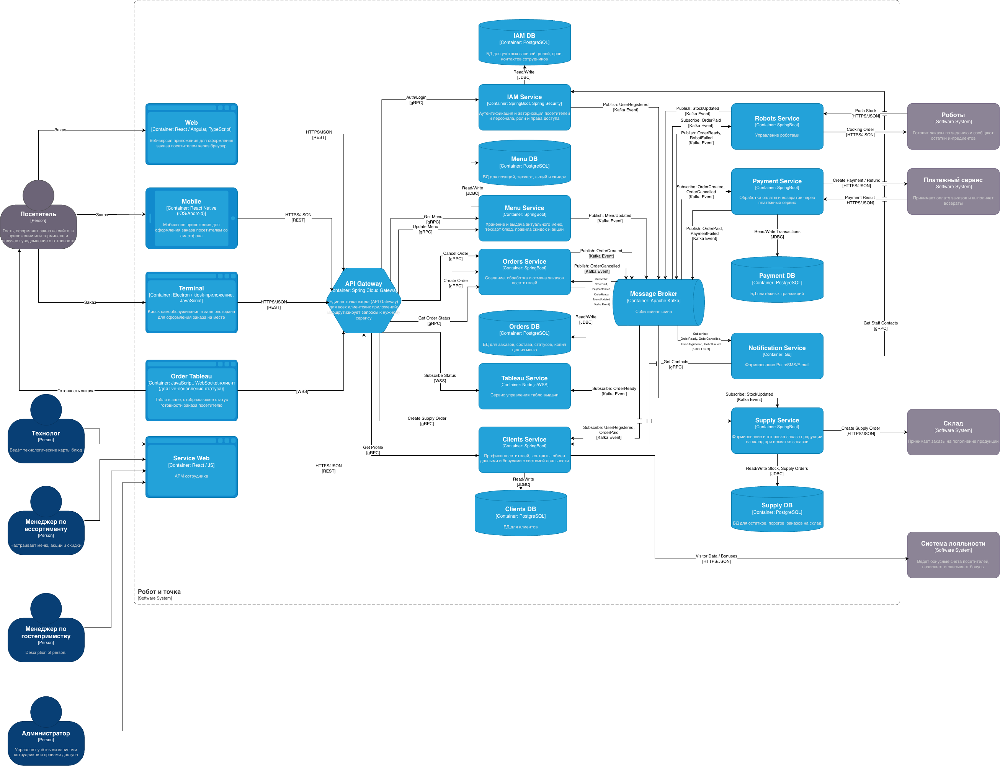
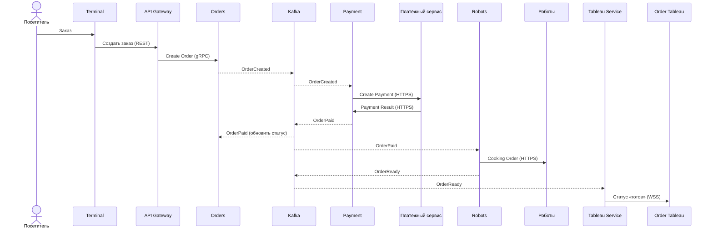

# Робот и точка — микросервисная архитектура (C4, уровни 1–2)

Учебный проект (OTUS, «Системный аналитик. Advanced», ДЗ 10): архитектура системы заказа еды
на точке с роботизированным приготовлением. Монолитная C4-диаграмма переведена на модель
**«Микросервисы»** и описана таблицами компонентов и информационных потоков.

## Диаграммы

**Уровень 1. Контекст**: кто и какие внешние системы взаимодействуют с системой.

**Уровень 2. Контейнеры (микросервисы)**: клиентские приложения, API Gateway, сервисы, базы данных, Kafka.

Исходник диаграммы: [`diagrams/c4-microservices.drawio`](diagrams/) (открывать в [draw.io](https://app.diagrams.net)).
Файл `legacy-c4-monolith.drawio` — исходная монолитная версия до перевода на микросервисы.

## Главный сценарий: заказ → оплата → готовка → табло

## Стек и протоколы

| Связь | Протокол |
|---|---|
| Клиентские приложения → API Gateway | HTTPS/JSON (REST) |
| Order Tableau ↔ API Gateway ↔ Tableau Service | WSS (WebSocket) |
| API Gateway → сервисы | gRPC |
| Сервис ↔ сервис (синхронно) | gRPC |
| Сервис ↔ сервис (события) | Apache Kafka |
| Сервис → своя БД | JDBC (PostgreSQL) |
| Сервис ↔ внешняя система | HTTPS/JSON (допущение, API внешних систем неизвестен) |

## Документация

| Документ | Содержание |
|---|---|
| [01. Компоненты](docs/01-components.md) | Люди, внешние системы, контейнеры: назначение и взаимодействия |
| [02. Информационные потоки](docs/02-information-flows.md) | Источник, приёмник, данные, протокол |
| [03. События Kafka](docs/03-kafka-events.md) | Кто публикует, кто читает, что внутри события |
| [04. Архитектурные решения](docs/04-design-decisions.md) | Почему сделано именно так, принятые допущения |
